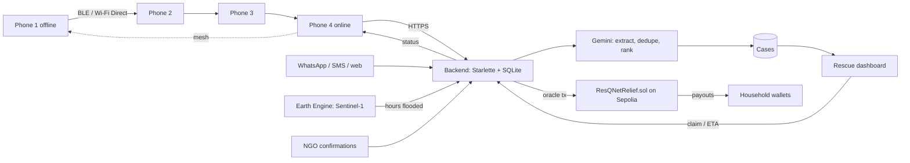

# ResQNet

**Rescued in hours, relief in days, every rupee traceable.**

ResQNet keeps flood victims reachable when mobile networks fail. It gets rescuers to the most urgent people first, and it pays affected households automatically.

| Part | Folder | What it does |
|---|---|---|
| Offline SOS mesh app (Android) | `mobile/` | SOS hops phone-to-phone over Bluetooth / Wi-Fi Direct (Google Nearby Connections) until one phone has internet. Packets are signed with Ed25519. |
| Control room backend + AI triage | `backend/` | Multilingual extraction (Gemini, or an offline fallback), deduplication, explainable urgency ranking, team suggestion, live updates |
| Dashboards | `backend/static/` | Rescue map, claim/close cases, mesh simulator, early-warning alerts, household enrolment, relief & payouts |
| Flood detection | `earth-engine/` | Sentinel-1 radar change detection → hours flooded per zone |
| Parametric payouts | `contracts/` | Solidity contract on Sepolia: pays when satellite reading ≥ 48 h **and** 2 of 3 NGOs confirm |
| Data | `data/` | 300 synthetic multilingual SOS messages, zones, OSM shelter fetcher |

Everything uses free tools. Without any keys the whole demo still runs in **offline mode**: rule-based AI, a blockchain simulator and the browser mesh simulator. Add keys to switch each part to the real service.



---

## 0. What you need (all free)

| Item | Where | Needed for |
|---|---|---|
| Python 3.11+ | python.org | Backend |
| Node.js 20 LTS | nodejs.org | Smart contract |
| Git + a GitHub account | github.com | Code hosting; GitHub Actions builds the APK and runs the tests |
| Gemini API key | https://aistudio.google.com → *Get API key* | AI triage and alerts (optional) |
| Render account | https://render.com (sign in with GitHub) | Free public hosting (optional; you can run on a laptop) |
| Earth Engine access + Cloud project ID | https://earthengine.google.com → *Get started* → non-commercial | Satellite flood readings |
| MetaMask with a **new, test-only** account | https://metamask.io | Deploys the contract; acts as the oracle wallet |
| ~0.1 Sepolia ETH | Google Cloud Web3 faucet (https://cloud.google.com/application/web3/faucet/ethereum/sepolia) or another Sepolia faucet | Gas + relief pool |
| Alchemy account → Sepolia app → HTTPS URL | https://alchemy.com | RPC connection to Sepolia |
| 3–4 Android phones (Android 8+) | Teammates | Real mesh demo |

> **Security:** use a MetaMask account that will only ever hold test ETH. Its private key goes into `.env`, which is git-ignored. Never commit `.env` and never paste keys into chats.

---

## 1. Run it locally (10 minutes, no keys)

```bash
git clone https://github.com/<you>/resqnet.git && cd resqnet
cp .env.example .env                 # Windows: copy .env.example .env  - keys go in .env, NOT .env.example
cd backend
python -m venv .venv && source .venv/bin/activate     # Windows: .venv\Scripts\activate
pip install -r requirements.txt
python -m unittest discover tests -v                  # 9 tests should pass
uvicorn app:app --host 0.0.0.0 --port 8000
```

Open http://localhost:8000:

1. **Rescue ops** → *Load demo messages*. 276 messy messages in Telugu, Tamil, Hindi, Hinglish and English collapse into about 64 ranked cases (the dataset has 60 real incidents). Each case shows why it ranks where it does.
2. Click a case → *Claim case* (a team is suggested by distance and medical capability). Trying to claim it from another browser returns *already claimed*.
3. **Mesh simulator** → press SOS on phone 1 → tick *network* on phone 4. The SOS hops 1→2→3→4, gets uploaded and appears as a case. Claim it on the dashboard and phone 1 shows *"Help on the way …"*.
4. **Early warning** → generate a Telugu alert → ▶ Play.
5. **Relief & payouts** → *Enrol demo households* → *Submit satellite readings* → click two NGOs' *confirms* on a zone flooded ≥ 48 h → payouts appear in the audit trail.

## 2. Turn on Gemini

Put `GEMINI_API_KEY=...` in `.env` and restart uvicorn. The header pill changes to **AI: gemini**. Messages are sent in batches of 25 to stay within the free-tier limits. If the quota runs out, the backend falls back to the offline extractor automatically.

> The Google AI Studio free tier may use prompts to improve Google's models, so only send synthetic or consented data.

## 3. Real satellite readings (Earth Engine)

Option A, browser: open https://code.earthengine.google.com, paste `earth-engine/flood_zones.js` and click Run. The map shows the flood extent. Copy the JSON from the Console into `data/flood_readings.json`.

Option B, Python:
```bash
pip install earthengine-api
earthengine authenticate
python earth-engine/flood_zones.py --project YOUR_CLOUD_PROJECT_ID
```
When `data/flood_readings.json` exists, the backend uses it instead of `flood_readings_sample.json`, which only has placeholder values.

## 4. Real payouts on Sepolia

```bash
cd contracts
npm install            # contracts/.npmrc makes npm retry dropped downloads
npx hardhat test       # 10 contract tests
# in ../.env set SEPOLIA_RPC_URL and ORACLE_PRIVATE_KEY (test-only MetaMask key, with ~0.1 Sepolia ETH)
npm run deploy:sepolia
```
The deploy script deploys the contract, creates 3 NGO wallets and funds them with gas, grants their roles, funds the pool with 0.03 ETH, and prints the lines to add to `.env` (`CHAIN_MODE=sepolia`, `CONTRACT_ADDRESS`, `NGO_PRIVATE_KEYS`). Restart the backend. Every enrolment, reading, confirmation and payout is then a real Sepolia transaction with an Etherscan link.

Optional: verify the source on Etherscan with the command the script prints (needs `ETHERSCAN_API_KEY`).

**If `npm install` fails with ECONNRESET / EPERM (common on Windows):** close VS Code, delete `contracts/node_modules` and `package-lock.json`, and run `npm install` again from a plain PowerShell window. If it still fails, try a mobile hotspot, turn off any VPN, or move the project out of a OneDrive-synced `Documents` folder (for example to `C:\dev\resqnet`).
**No npm at all?** Deploy from the browser with https://remix.ethereum.org: paste `ResQNetRelief.sol`, compile with 0.8.24 and EVM version `cancun`, deploy through *Injected Provider – MetaMask* on Sepolia with constructor arguments `1000000000000000, 48, 2`, then put the address in `.env`.

## 5. Deploy the backend for free (Render)

1. Push this repo to GitHub.
2. Render → **New → Blueprint** → pick the repo. `render.yaml` sets everything up.
3. In the service's **Environment** tab, add `GEMINI_API_KEY`, plus the Sepolia variables if you use them.
4. Your control room is now at `https://resqnet-xxxx.onrender.com`.

Free-tier notes: the service sleeps after 15 minutes idle (open it a minute before the demo), and SQLite is wiped on every redeploy. Click *Load demo messages* again after a redeploy.

## 6. Build the Android app (no Android Studio needed)

1. On GitHub, go to **Actions → Build Android APK → Run workflow** and enter your Render URL (or `http://<laptop-LAN-IP>:8000`).
2. After about 8 minutes, download the `resqnet-apk` artifact, unzip it and copy `app-release.apk` to each phone. Install it (allow "install unknown apps").
3. On first launch, allow Location, Nearby devices and Bluetooth, and turn on GPS. The server URL can be changed later under ⚙ settings.

To build locally instead, install Flutter 3.24+ and Android Studio, then:
```bash
cd mobile
flutter create --org org.resqnet --project-name resqnet_app --platforms android .
cp android_overrides/AndroidManifest.xml android/app/src/main/AndroidManifest.xml
# in android/app/build.gradle set minSdk = 23
flutter run --dart-define=SERVER_URL=http://<laptop-ip>:8000
```

**Mesh test:** put phones 1–3 in airplane mode, then turn Bluetooth and Wi-Fi back ON (airplane mode switches them off). Keep phone 4 online. Keep the app open on all phones. Send an SOS from phone 1. The *Mesh activity* log shows each hop.

Limits (state these openly): Android only, because iOS restricts background Bluetooth. Relaying happens while the app is open (a foreground service is on the roadmap). Range is about 10–100 m per hop.

## 7. Other useful bits

- `python data/fetch_osm.py` downloads real shelters and hospitals from OpenStreetMap into `data/shelters.json`.
- `python data/generate_sos.py` regenerates the synthetic dataset.
- `/enroll` is the household enrolment form for residents and NGO field workers. Only a salted hash and the zone go on-chain.
- **Fraud checks:** households enrolled after a payout triggers are not paid (`WAITING_PERIOD_S` in the contract and backend; use about 7 days in production). Devices that send bursts of SOS from far-apart places are flagged and down-ranked. Signed packets with a changed key are rejected.

## API cheat sheet

| Method | Path | Purpose |
|---|---|---|
| POST | `/api/sos` | One packet or a list `{id, text, lat, lng, ts, people, needs, device_id, sig, pk}` → `{acks}` |
| GET | `/api/sos/status?ids=a,b` | Rescue status per SOS (relayed back through the mesh) |
| GET | `/api/cases`, `/api/cases/{id}` | Ranked cases; detail with original messages and team suggestion |
| POST | `/api/cases/{id}/claim` `{team_id, eta_min}` · `/close` · `/release` · `/override` `{score}` | Responder actions |
| POST | `/api/households` `{name, phone, zone_id}` | Enrol (hash on-chain) |
| POST | `/api/relief/readings/load` · `/api/relief/confirm` `{ngo_id, zone_id}` · `/api/relief/process` | Payout flow |
| GET | `/api/alerts/forecast` · POST `/api/alerts/generate` `{lang}` | Early warning |
| GET | `/api/events` | Server-sent events for live dashboards |

## What is tested, and what isn't

- **Tested in the build environment:** backend unit tests (extraction in 5 languages, dedup accuracy on the synthetic set, signature verification, payout rules), every API endpoint, and all dashboard pages in a headless browser, including the full mesh-simulator loop (SOS → 3 hops → upload → claim → "help on the way").
- **Written but not run there:** the Flutter app, the Solidity contract and Hardhat tests, the Earth Engine scripts, and the live Gemini, Open-Meteo, gTTS and Sepolia calls. That environment had no internet access to fetch Flutter, the Solidity compiler or Python/npm packages. The GitHub Actions workflows (`tests.yml`, `android-apk.yml`) compile and test them on the first push. If one fails, open the failing step's log; the fix is usually a version bump.
